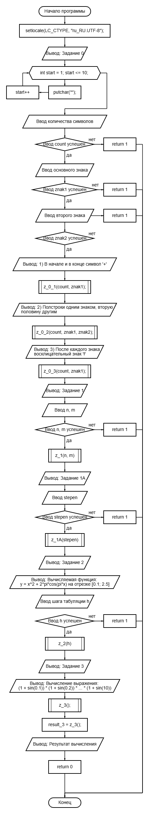
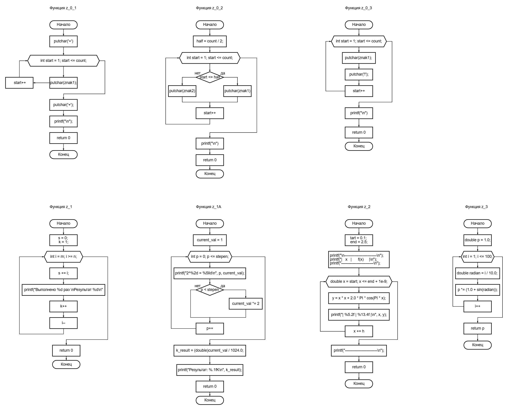
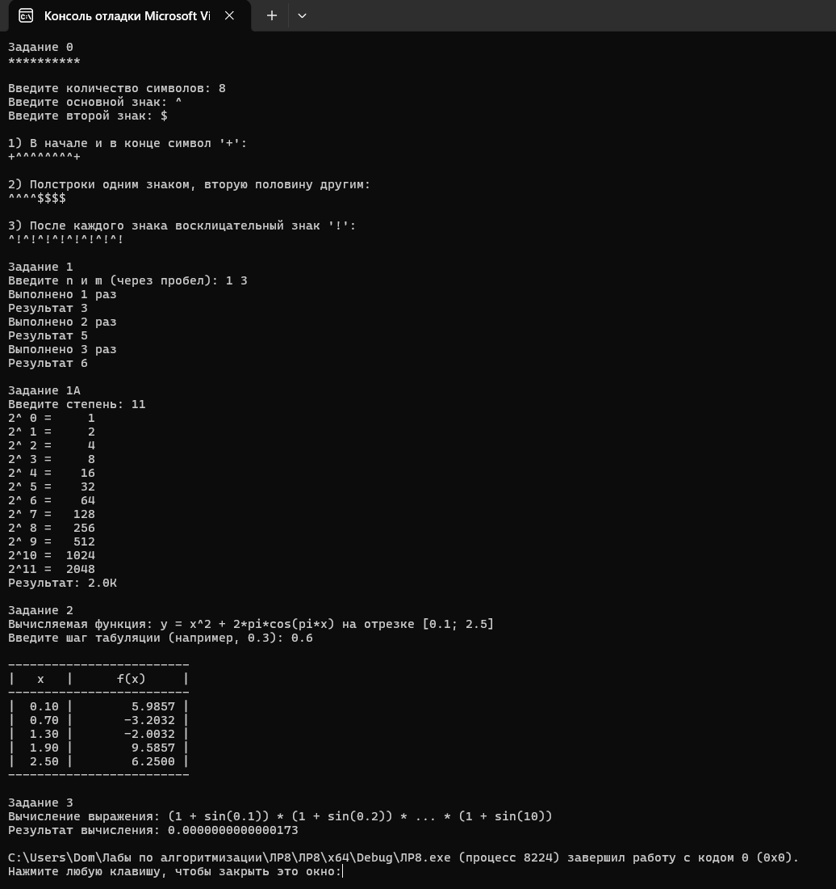

# Лабораторная работа 8

## Цель работы
Получение навыков написания программ с использованием цикла  c параметрами

## Блок-схема

## Результаты работы программы

## Информация о разработчике
Орлова Эльвира Эдуардовна
Группа: бИД-261
